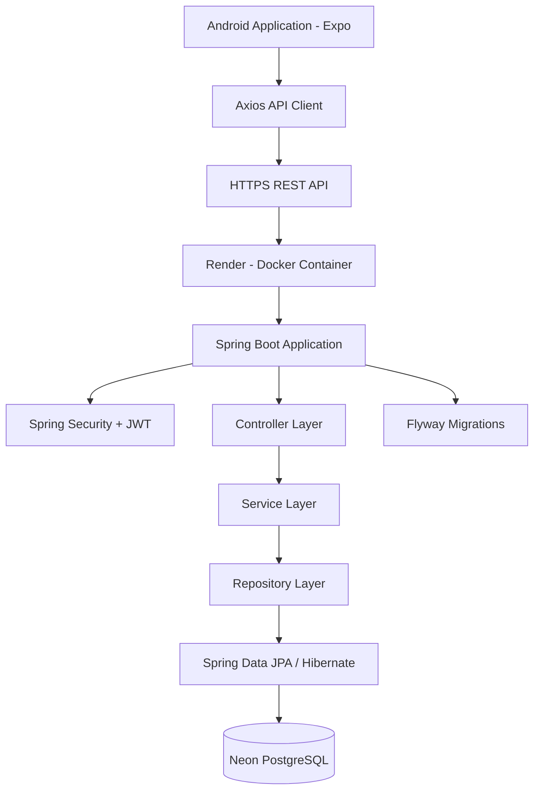

# Student Management System (SMS)

A full-stack Student Management System built with **React Native (Expo), Spring Boot, Spring Data JPA, PostgreSQL, and Redux Toolkit**.

The application provides role-based access for Students and Teachers, secure authentication, student performance tracking, dynamic rankings, and teacher-controlled point management.

The backend is containerized with Docker, deployed on Render and connected to a managed PostgreSQL database hosted on Neon.

---

## Live Deployment

| Component | Technology | Status |
|---|---|---|
| Mobile Application | React Native + Expo | Android APK |
| Backend API | Spring Boot 3.3.5 | Deployed |
| Database | Neon PostgreSQL 18.7 | Connected |
| Containerization | Docker | Configured |
| Backend Hosting | Render | Live |
| Authentication | Spring Security + JWT | Implemented |

**Backend URL:**  
https://student-management-system-juu8.onrender.com

**API Base URL:**
```text
https://student-management-system-juu8.onrender.com/api/v1
```

---

## Key Features

### 1. Authentication & Authorization

- Student and Teacher registration.
- Secure user authentication.
- JWT-based authentication.
- Role-based access control (RBAC).
- Protected application routes.
- Role-specific application interfaces.
- Persistent authentication sessions.
- Secure token storage on supported devices.

### 2. Student Management

- Student profile management.
- Student performance tracking.
- Individual point records.
- Student ranking and leaderboard.
- Performance visibility based on user roles.

### 3. Dynamic Leaderboard

- Ranking based on total student points.
- Descending point-based sorting.
- Deterministic ranking for tied scores.
- Paginated leaderboard data.
- Student-specific performance information.
- Immediate leaderboard updates following successful point transactions.

### 4. Teacher Administration

- Teacher-specific administrative interface.
- Review student performance.
- Award points to students.
- Adjust student points through authorized operations.
- Manage student performance records.

### 5. Frontend State Management

- Centralized state management using Redux Toolkit.
- Authentication state management.
- Student and leaderboard state management.
- Asynchronous API communication.
- Context API for global application configuration.
- Persistent authentication state.

### 6. Theme Management

- Global theme management.
- Light mode and dark mode.
- Theme switching across application screens.
- Centralized theme configuration.

---

## Technology Stack

### Frontend

| Technology | Purpose |
|---|---|
| React Native | Cross-platform mobile development |
| Expo SDK 51 | Mobile application development |
| TypeScript | Type safety |
| Redux Toolkit | Centralized state management |
| React Redux | Redux integration |
| React Navigation | Application navigation |
| Context API | Global application state |
| Expo SecureStore | Secure local token storage |
| Axios | HTTP communication |

### Backend

| Technology | Purpose |
|---|---|
| Java 17 | Backend development |
| Spring Boot 3.3.5 | REST API development |
| Spring Web | REST controllers |
| Spring Security 6 | Application security |
| Spring Data JPA | Database operations |
| Hibernate | ORM |
| JWT (JJWT) | Token-based authentication |
| Hibernate Validator | Request validation |
| Maven | Dependency and build management |

### Database & Infrastructure

| Technology | Purpose |
|---|---|
| PostgreSQL 18.7 | Relational database |
| Neon | Managed cloud PostgreSQL |
| Flyway | Database schema migrations |
| Docker | Application containerization |
| Docker Compose | Container orchestration tooling |
| Render | Backend deployment |
| Expo EAS | Android APK builds |
| Git & GitHub | Version control |

---

## System Architecture



### Backend Architecture

The backend follows the Controller-Service-Repository architectural pattern.

- **Controller Layer:** Handles HTTP requests and API responses.
- **Service Layer:** Contains business logic and application operations.
- **Repository Layer:** Handles database interactions using Spring Data JPA.
- **Security Layer:** Handles authentication and role-based authorization.
- **Database Layer:** Stores application data in PostgreSQL.

### Frontend Architecture

The frontend uses a feature-oriented state management approach.

- Redux Toolkit manages authentication and dynamic application data.
- Async actions handle backend communication.
- Context Providers manage global application configuration.
- React Navigation handles screen navigation.
- Persistent storage supports authentication across application restarts.

---

## Database & Migrations

The application uses PostgreSQL with Spring Data JPA and Hibernate.

Database schema management is handled by Flyway.

### Migration History

| Version | Migration |
|---|---|
| V1 | Initial schema |
| V2 | Class enrollment schema |

Both migrations have been successfully applied to the Neon PostgreSQL database.

Hibernate schema validation is enabled using:

```yaml
spring:
  jpa:
    hibernate:
      ddl-auto: validate
```

This allows Hibernate to validate the database schema without automatically recreating or modifying it.

---

## Docker Configuration

The backend is packaged using a multi-stage Docker build.

### Build Docker Image

Navigate to the backend directory:

```bash
cd backend
```

Build the image:

```bash
docker build -t student-management-system:local .
```

### Run Docker Container

```bash
docker run -d \
  --name sms-backend \
  -p 18080:8080 \
  --env-file .env.docker \
  student-management-system:local
```

### View Container Logs

```bash
docker logs -f sms-backend
```

### Check Running Containers

```bash
docker ps
```

The Docker image uses Java 17 and runs the Spring Boot application as a non-root user.

**Note:** The `.env.docker` file is used for local container configuration and must not be committed to GitHub.

---

## Environment Configuration

Create environment variables for the backend.

Example `.env.example`:

```env
SERVER_PORT=8080

SPRING_DATASOURCE_URL=jdbc:postgresql://localhost:5432/sms_db
SPRING_DATASOURCE_USERNAME=postgres
SPRING_DATASOURCE_PASSWORD=your_database_password

SPRING_JPA_SHOW_SQL=false

JWT_SECRET=your_base64_encoded_secret
JWT_EXPIRATION_MS=86400000

TEACHER_INVITATION_CODE=your_private_invitation_code
```

For production deployment, configure the following environment variables in Render:

```text
SPRING_DATASOURCE_URL
SPRING_DATASOURCE_USERNAME
SPRING_DATASOURCE_PASSWORD
JWT_SECRET
JWT_EXPIRATION_MS
TEACHER_INVITATION_CODE
```

The production datasource uses the Neon PostgreSQL connection with SSL enabled.

**Security:** Never commit actual database passwords, JWT secrets, invitation codes, or private environment files to version control.

---

## Local Development Setup

### Prerequisites

Install the following:

- Node.js
- Java 17 or later
- Maven
- PostgreSQL (for local database development)
- Docker Desktop
- Expo CLI / EAS CLI

### 1. Clone the Repository

```bash
git clone https://github.com/Swayam-TheCoder/Student_Management_System.git
```

```bash
cd FinalProject
```

### 2. Start the Backend

```bash
cd backend
```

Configure your environment variables, then run:

```bash
mvn spring-boot:run
```

The backend runs on:

```text
http://localhost:8080
```

### 3. Start the Frontend

Open another terminal:

```bash
cd frontend
```

Install dependencies:

```bash
npm install
```

Start Expo:

```bash
npx expo start
```

Configure the frontend API URL to point to your backend.

For a physical Android device, use an accessible backend IP address or tunnel instead of `localhost`.

---

## Android APK Build

The application uses Expo Application Services (EAS) for Android builds.

Configure the Preview environment variable:

```env
EXPO_PUBLIC_API_URL=https://student-management-system-juu8.onrender.com/api/v1
```

Build the Android APK:

```bash
eas build --platform android --profile preview
```

Once the build completes, download and install the generated APK on an Android device.

---

## Deployment Architecture

The production deployment uses the following architecture:

```text
Android APK
    |
    | HTTPS API Requests
    v
Render Web Service
    |
    | Docker Container
    v
Spring Boot REST API
    |
    | JDBC + SSL
    v
Neon PostgreSQL
```

### Deployment Details

**Backend Hosting:** Render

**Database Hosting:** Neon PostgreSQL

**Containerization:** Docker

**Mobile Builds:** Expo EAS

The backend and database are independently hosted, allowing the mobile application to communicate with the cloud backend without depending on a developer's local machine.

---

## Security Considerations

- JWT-based authentication.
- Spring Security authorization.
- Role-based access control.
- Protected API operations.
- Request validation.
- Centralized exception handling.
- Secure configuration through environment variables.
- HTTPS communication in production.
- Database credentials excluded from the Docker build context.

---

## Project Evaluation Coverage

| Evaluation Area | Implementation |
|---|---|
| Authentication & RBAC | JWT authentication and Student/Teacher roles |
| Redux & State Architecture | Redux Toolkit and Context Providers |
| Rank List & Point Mechanics | Dynamic rankings and teacher point operations |
| Backend Architecture & SQL | Spring Boot, JPA, PostgreSQL and Flyway |
| API Design & Live Demo | REST API, Docker and cloud deployment |

---

## Future Improvements

- Automated backend and frontend test pipelines.
- Expanded API integration and performance testing.
- Improved leaderboard caching.
- Push notifications for student performance updates.
- Analytics dashboards.
- Monitoring and structured production logging.
- Automated CI/CD deployment.

---

## Author

**Swayam Sagarkar**

Built as a full-stack academic project demonstrating mobile application development, backend engineering, database management, authentication, state architecture, containerization and cloud deployment.

---

**Project:** Student Management System  
**Backend:** Spring Boot 3.3.5  
**Frontend:** React Native + Expo SDK 51  
**Database:** PostgreSQL  
**Deployment:** Render + Neon + Docker
