# Student Management System - System Flows & Feature Specification

This document provides architectural and technical documentation detailing the visual execution flows, domain workflows, security boundaries, and implemented features of the **Student Management System (SMS)**.

---

## 1. Domain Model & System Architecture

The application implements a strict **Controller-Service-Repository** architectural pattern on the backend coupled with a **Redux Toolkit + Context API** feature-sliced architecture on the frontend.

### Architecture Diagram



<details>
<summary><b>View Component Mapping & Interaction Specifications</b></summary>

- **Frontend Client (`React Native / Expo SDK 51`)**:
  - `UI Screens & Layouts`: Student & Teacher Navigators, responsive containers (`ScreenContainer`).
  - `ThemeContext`: React Context API providing real-time switching between Light (`#f8fafc`) and Dark (`#0b0f19`) modes.
  - `Redux Toolkit`: Centralized state management for `authSlice` (user identity, profiles, session state) and `leaderboardSlice` (cached rankings, pagination).
  - `SecureStore / LocalStorage`: Hardware-backed AES-256 encrypted storage on iOS/Android; persistent `localStorage` on Expo Web.
  - `Axios Client`: Configured with base URL dynamic resolution and request/response interceptors.
- **Spring Security 6 Gateway (Stateless)**:
  - `CorsConfigurationSource`: Strict whitelist of origins, HTTP verbs (`GET`, `POST`, `PUT`, `PATCH`, `DELETE`, `OPTIONS`), and headers.
  - `JwtAuthenticationFilter`: Extracts Bearer JWT, validates HMAC-SHA256 signature and expiration, populates `SecurityContext`.
  - `JwtAuthenticationEntryPoint`: Catches unauthenticated requests and returns standardized `401 Unauthorized`.
- **Spring Boot 3.3.5 Backend (Controller-Service-Repository)**:
  - `REST Controllers`: `AuthController`, `StudentController`, `PointController`, `LeaderboardController`.
  - `Service Implementations`: `AuthServiceImpl`, `StudentServiceImpl`, `PointServiceImpl`, `LeaderboardServiceImpl`.
  - `Repositories`: Spring Data JPA with `@Lock(LockModeType.PESSIMISTIC_WRITE)`.
- **PostgreSQL 18 Relational Persistence**:
  - `users`: Core identity table with unique email, 12-round BCrypt password hash, role (`STUDENT`, `TEACHER`), and account status.
  - `student_profiles`: One-to-one foreign key with `users`, unique student ID number, class level, total points balance.
  - `teacher_profiles`: One-to-one foreign key with `users`, unique employee ID, department name.
  - `point_transactions`: Immutable append-only audit ledger with student FK, teacher FK, points delta, transaction category, and reason.

</details>

---

## 2. End-to-End System Execution Flows

### Flow 1: Role-Based Registration & Onboarding

Both `STUDENT` and `TEACHER` accounts register through dedicated schemas validated client-side with **Zod** and server-side with **Hibernate Validator**.

#### Visual Registration Workflow



<details>
<summary><b>Workflow Execution Details</b></summary>

1. **User Interaction**:
   - User opens `RegisterScreen` and selects role tab (**Student** or **Teacher**).
   - Form renders contextual fields (Student ID & Grade Level for Students; Employee ID, Department & Invitation Secret for Teachers).
2. **Client-Side Validation (Zod)**:
   - Form validated via `@hookform/resolvers/zod`. If fields are invalid, visual error messages display inline below corresponding inputs.
3. **HTTP Dispatch**:
   - Axios sends `POST /api/v1/auth/register` with JSON payload.
4. **Server-Side Validation & Security**:
   - `AuthController` validates DTO via `@Valid`.
   - `AuthServiceImpl` verifies teacher invitation secret (`TEACHER_SECRET_2026`). If invalid, returns `400 Bad Request`.
   - Uniqueness check on `email`, `studentIdNumber`, and `employeeId`. Duplicates return `409 Conflict`.
5. **Database Persistence**:
   - Password hashed with `BCryptPasswordEncoder(12)`.
   - `User` entity persisted, followed by `StudentProfile` or `TeacherProfile`.
6. **Token Generation & Session Bootstrapping**:
   - `JwtTokenProvider` signs a 24-hour HMAC-SHA256 JWT containing `subject` (email), `role`, `id`, and `profileId`.
   - Returns `HTTP 201 Created` with `AuthResponse`.
   - Frontend securely writes token to `SecureStore` (`sms_auth_token`), updates Redux `isAuthenticated = true`, and redirects to the role-specific dashboard.

</details>

---

### Flow 2: Session Restoration & Automatic Re-Hydration

When the mobile app cold-starts or the web browser reloads, the user's authenticated session is securely verified and re-hydrated without requiring credential re-entry.

#### Visual Session Restoration Workflow



<details>
<summary><b>Workflow Execution Details</b></summary>

1. **App Mount & Splash Screen**:
   - Application displays `SplashScreen` while `RootNavigator` initializes.
   - Redux dispatches `restoreAuth()` async thunk.
2. **Secure Token Lookup**:
   - Reads `sms_auth_token` from device hardware-backed storage (`Expo SecureStore` or `localStorage`).
3. **Branch A: Missing Token**:
   - Redux sets `isAuthenticated = false`, `isRestoringAuth = false`.
   - `RootNavigator` routes to `AuthNavigator` displaying `LoginScreen`.
4. **Branch B: Token Found**:
   - Axios request interceptor attaches `Authorization: Bearer <token>`.
   - Sends `GET /api/v1/auth/me`.
   - `JwtAuthenticationFilter` validates token signature and expiry date:
     - **If Expired/Tampered**: Gateway rejects with `401 Unauthorized`. Axios response interceptor intercepts 401, invokes `SecureStore.removeToken()`, resets Redux auth state, and routes user to `LoginScreen`.
     - **If Valid**: `AuthServiceImpl.getCurrentUserProfile()` fetches user and profile details, returning `200 OK` (`UserProfileResponse`).
5. **Role-Based Navigation Branching**:
   - Redux hydrates `user`, `studentProfile`, `teacherProfile`, sets `isAuthenticated = true`, and sets `isRestoringAuth = false`.
   - `RootNavigator` dynamically mounts:
     - **Student**: `StudentNavigator` (Dashboard, Leaderboard, Point History, Profile, Settings).
     - **Teacher**: `TeacherNavigator` (Faculty Dashboard, Student Directory, Award Points, Leaderboard, Dossier).

</details>

---

### Flow 3: Faculty Point Allocation & Concurrency Guard Flow

Teachers allocate merits, record disciplinary penalties, or apply adjustments. Database-level **pessimistic row locking** guarantees data consistency and prevents lost updates during simultaneous modifications.

#### Visual Point Allocation Workflow



<details>
<summary><b>Workflow Execution Details</b></summary>

1. **Faculty Action**:
   - Authenticated teacher opens `AwardPointsScreen`, selects target student from class roster, picks transaction category (`ACADEMIC`, `PARTICIPATION`, `BEHAVIOR`, `PENALTY`, `ADJUSTMENT`), selects point amount (`+10`, `+25`, `+50`, `+100`, `-10`, `-25`, or custom value), and inputs mandatory reason.
   - System prompts user with a native confirmation dialog displaying student name, point delta, and reason.
2. **Security & Authorization**:
   - Request dispatched to `POST /api/v1/points/award`.
   - Spring Security evaluates `@PreAuthorize("hasRole('TEACHER')")`. Non-teacher attempts receive `403 Forbidden`.
3. **Atomic Transaction Boundary (`@Transactional`)**:
   - **Teacher Verification**: Looks up teacher profile. Throws `404 Not Found` if missing.
   - **Pessimistic Row Lock**: Executes `SELECT s FROM StudentProfile s WHERE s.id = :id FOR UPDATE` (`findByIdWithLock`). The target student's database row is locked against concurrent transactions until commit or rollback.
   - **Penalty Sign Inversion**: If category is `PENALTY` and points are positive, delta is inverted: `pointsDelta = -pointsDelta`.
   - **Negative Balance Guard**: Calculates `newTotal = currentTotal + pointsDelta`.
     - **If `newTotal < 0`**: Throws `BadRequestException("Insufficient points: cannot deduct X from balance Y")`. Spring triggers an immediate rollback, releases all locks, and returns `400 Bad Request`.
     - **If `newTotal >= 0`**:
       - Inserts immutable `PointTransaction` record into PostgreSQL.
       - Updates `StudentProfile.total_points = newTotal`.
       - Database transaction commits and releases row lock.
4. **Client-Side Propagation**:
   - Backend returns `200 OK` with `AwardPointsResponse` containing `updatedTotalPoints` and `PointTransactionDto`.
   - Redux dispatches `refreshLeaderboard()` to invalidate stale cached rankings.
   - UI presents a success feedback banner with updated point total.

</details>

---

### Flow 4: Dynamic Leaderboard & Competition Ranking Flow

The dynamic leaderboard relies on server-side window functions to calculate standard competition ranks, ensuring tie handling and pagination stability across large student populations.

#### Visual Leaderboard Workflow



<details>
<summary><b>Workflow Execution Details</b></summary>

1. **Request & Pagination**:
   - User navigates to `LeaderboardScreen` (or pulls down to refresh).
   - Redux dispatches `fetchLeaderboard({ page: 0, size: 20 })`.
   - Axios queries `GET /api/v1/leaderboard?page=0&size=20`.
2. **PostgreSQL Window Function Evaluation**:
   - `StudentProfileRepository` runs native query:
     ```sql
     SELECT sp.id AS studentId,
            sp.student_id_number AS studentIdNumber,
            CONCAT(u.first_name, ' ', u.last_name) AS studentName,
            sp.grade_level AS gradeLevel,
            sp.total_points AS totalPoints,
            RANK() OVER (ORDER BY sp.total_points DESC) AS rank
     FROM student_profiles sp
     JOIN users u ON sp.user_id = u.id
     WHERE u.is_active = true
     ORDER BY sp.total_points DESC, sp.id ASC
     ```
3. **Standard Competition Ranking Rules**:
   - Students with tied point balances receive the exact same rank position.
   - Example verified in live QA:
     - `Student A`: 290 pts $\rightarrow$ **Rank #1**
     - `Student B`: 150 pts $\rightarrow$ **Rank #2**
     - `Student C`: 150 pts $\rightarrow$ **Rank #2 (Tied)**
     - `Student D`: 90 pts $\rightarrow$ **Rank #4 (Rank 3 Skipped)**
4. **Client-Side Rendering**:
   - Backend wraps results in `PagedResponse<LeaderboardEntryDto>`.
   - Redux updates `leaderboardSlice`.
   - **Top 3 Podium**: Rendered via `PodiumCard` with 2nd place (Silver, left), 1st place (Gold, elevated center), and 3rd place (Bronze, right) on responsive stands.
   - **Remaining Roster**: Rendered via virtualized `FlatList` with `LeaderboardRow` components featuring rank circles, grade pills, total points capsules, and an active **"YOU"** badge for the authenticated student.

</details>

---

## 3. Comprehensive Implemented Feature Matrix

| Feature Area | Module | Implementation Details | Tested Status |
| :--- | :--- | :--- | :--- |
| **Authentication** | [AuthController.java](file:///c:/Users/swaya/Development/FullStack%20HONORS/FinalProject/backend/src/main/java/com/sms/controller/AuthController.java) | Stateless JWT authentication, 12-round BCrypt encryption, teacher secret verification. | **Verified (20/20 QA)** |
| **Session Persistence** | [secureStorage.ts](file:///c:/Users/swaya/Development/FullStack%20HONORS/FinalProject/frontend/src/utils/secureStorage.ts) | Encrypted token storage via `Expo SecureStore` (native) and `localStorage` (web). | **Verified** |
| **Protected Navigation** | [RootNavigator.tsx](file:///c:/Users/swaya/Development/FullStack%20HONORS/FinalProject/frontend/src/navigation/RootNavigator.tsx) | Dynamic route guarding based on auth status and role (`STUDENT` vs `TEACHER`). | **Verified** |
| **Student Directory** | [StudentDirectoryScreen.tsx](file:///c:/Users/swaya/Development/FullStack%20HONORS/FinalProject/frontend/src/features/teacher/StudentDirectoryScreen.tsx) | Live search across name, email, student ID; paginated roster listing. | **Verified** |
| **Student Dossier** | [StudentDetailsScreen.tsx](file:///c:/Users/swaya/Development/FullStack%20HONORS/FinalProject/frontend/src/features/teacher/StudentDetailsScreen.tsx) | Detailed student profile view with quick point allocation trigger. | **Verified** |
| **Point Allocation** | [AwardPointsScreen.tsx](file:///c:/Users/swaya/Development/FullStack%20HONORS/FinalProject/frontend/src/features/teacher/AwardPointsScreen.tsx) | Preset chip buttons (`+10`, `+25`, `+50`, `+100`, `-10`, `-25`), custom point values, categories. | **Verified** |
| **Concurrency Guard** | [PointServiceImpl.java](file:///c:/Users/swaya/Development/FullStack%20HONORS/FinalProject/backend/src/main/java/com/sms/service/impl/PointServiceImpl.java) | Pessimistic locking (`PESSIMISTIC_WRITE`) guarantees isolation during concurrent point changes. | **Verified** |
| **Transaction Ledger** | [PointHistoryScreen.tsx](file:///c:/Users/swaya/Development/FullStack%20HONORS/FinalProject/frontend/src/features/student/PointHistoryScreen.tsx) | Immutable point ledger with faculty attribution, timestamp, and reason tags. | **Verified** |
| **Dynamic Leaderboard** | [LeaderboardScreen.tsx](file:///c:/Users/swaya/Development/FullStack%20HONORS/FinalProject/frontend/src/features/leaderboard/LeaderboardScreen.tsx) | Top 3 podium stand visualization with medal badges and current user indicator. | **Verified** |
| **Theming Engine** | [ThemeContext.tsx](file:///c:/Users/swaya/Development/FullStack%20HONORS/FinalProject/frontend/src/context/ThemeContext.tsx) | Instant Light & Dark mode toggle persisted to device storage. | **Verified** |
| **Responsive Containers** | [ScreenContainer.tsx](file:///c:/Users/swaya/Development/FullStack%20HONORS/FinalProject/frontend/src/components/layout/ScreenContainer.tsx) | Responsive maximum widths for 1920px desktop down to 375px mobile. | **Verified** |

---

## 4. Verification & QA Test Evidence

The automated test script [run_qa_tests.ps1](file:///c:/Users/swaya/Development/FullStack%20HONORS/FinalProject/run_qa_tests.ps1) executed the following 20 verification stages against the live application:

```
==========================================================
 STUDENT MANAGEMENT SYSTEM - AUTOMATED QA TEST SUITE     
 Target API: http://localhost:8080/api/v1                                     
==========================================================

[STAGE 1] System Health & Database Connectivity
 [PASS] Service is UP and PostgreSQL database is CONNECTED

[STAGE 2] Role-Based User Registration
 [PASS] Student registered with valid JWT token
 [PASS] Teacher registered with valid JWT token

[STAGE 3] Login & Credential Security
 [PASS] Student login succeeded with correct credentials
 [PASS] Invalid credentials correctly rejected with status 401

[STAGE 4] Session Restoration (/api/v1/auth/me)
 [PASS] Student /auth/me returns valid student profile session
 [PASS] Teacher /auth/me returns valid teacher profile session

[STAGE 5] Role-Based Access Control Guards
 [PASS] Unauthenticated request to protected endpoint returns 401 Unauthorized
 [PASS] Student attempting to access student directory returns 403 Forbidden
 [PASS] Student attempting to award points returns 403 Forbidden

[STAGE 6] Point Management Flow (Award, Deduct, Adjust)
 [PASS] Teacher awards 100 ACADEMIC points -> balance = 100
 [PASS] Teacher applies -25 PENALTY deduction -> balance = 75
 [PASS] Teacher applies +15 ADJUSTMENT -> balance = 90
 [PASS] Student profile reflects verified balance of 90 points
 [PASS] Student ledger contains exactly 3 immutable transaction records

[STAGE 7] Validation Guards & Rollback Consistency
 [PASS] Deduction exceeding student points balance rejected with 400 Bad Request
 [PASS] Awarding to non-existent student rejected with 404 Not Found

[STAGE 8] Dynamic Leaderboard & Competition Ranking
 [PASS] Tied scores (150 pts) share the exact same rank position
 [PASS] Lower score (90 pts) receives lower rank
 [PASS] Dynamic re-ordering: Elena promoted to Rank 1 with 290 points

==========================================================
 TEST RUN COMPLETE: 20 Passed, 0 Failed (100% Success)
==========================================================
```
